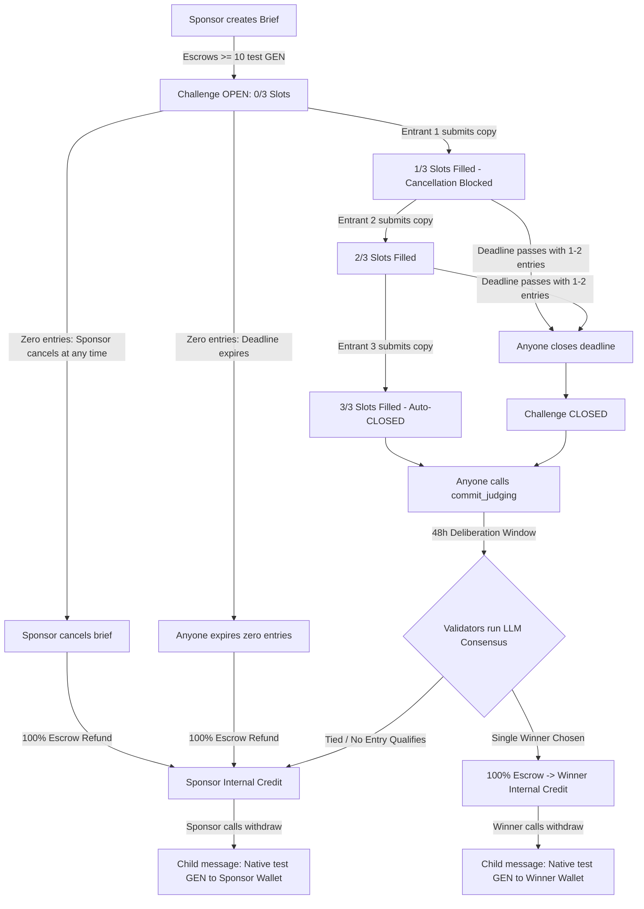

# BriefArena

> **Decentralized editorial copywriting arena powered by GenLayer Intelligent Contracts on Studio Next (Chain 61997).**

BriefArena brings competitive creative copywriting on-chain. Sponsors post editorial briefs with escrowed **test GEN** prizes. Copywriters submit high-impact short-form entries (one tagline and one launch paragraph). Once slots fill, GenLayer's consensus network of validators utilizes built-in large language models (LLMs) to objectively verify guidelines, evaluate nuance, and award the prize to a single winner entirely on-chain.

---

## Table of Contents
- [Why GenLayer?](#why-genlayer)
- [How BriefArena Works](#how-briefarena-works)
  - [1. Sponsor Brief Creation](#1-sponsor-brief-creation)
  - [2. Three-Entrant Submission Desk](#2-three-entrant-submission-desk)
  - [3. Validator LLM Judging](#3-validator-llm-judging)
  - [4. Single Winner Award & Settlement](#4-single-winner-award--settlement)
  - [5. Zero-Entry Cancellation & Refunds](#5-zero-entry-cancellation--refunds)
  - [6. Internal Credit vs. Wallet Withdrawal (Pull Payments)](#6-internal-credit-vs-wallet-withdrawal-pull-payments)
- [Live Contract & On-Chain Proof](#live-contract--on-chain-proof)
- [Project Architecture](#project-architecture)
- [Local Development Setup](#local-development-setup)
- [Running Tests](#running-tests)
- [Vercel Deployment Guide](#vercel-deployment-guide)
- [License](#license)

---

## Why GenLayer?

Traditional smart contracts (EVM, SVM) are strictly deterministic: they can tally tokens, compute cryptographic hashes, and verify arithmetic equations. However, they **cannot** judge creative writing, evaluate tone of voice, or verify semantic alignment with a creative brief without relying on centralized off-chain oracles or subjective multi-signature committees.

GenLayer introduces **Intelligent Contracts** written in Python executing inside the GenVM:
1. **Native LLM Inference (`gl.nondet.exec_prompt`)**: Contracts can execute natural language prompts directly during contract execution.
2. **Validator Consensus on Non-Deterministic Outputs (`gl.vm.run_nondet`)**: Multiple independent validators run the evaluation prompt. Rather than requiring bit-for-bit identical outputs, GenLayer achieves consensus via comparative equivalence, validating whether the leader's selected winner and rationale align with the prompt criteria.
3. **Trustless On-Chain Editorial Decisions**: Sponsors and writers interact with an autonomous, neutral judge that enforces negative constraints (prohibited words, length limits) and evaluates positive tenets (punchiness, clarity, brand fit) without human bias or platform fees.

---

## How BriefArena Works



### 1. Sponsor Brief Creation
- A sponsor creates an editorial brief on `/challenges/new`.
- **Inputs**:
  - Title (5–60 characters)
  - Category (3–40 characters)
  - Synopsis (40–500 characters)
  - Mandatory Tenets (1 to 4 items, each 5–120 characters)
  - Prohibited Terms (1 to 6 items, each 2–25 characters)
  - Duration (choice of 24h, 48h, 72h, or 168h)
  - Prize Escrow: Minimum **10 test GEN** (frozen in contract escrow upon creation).
- **Protocol Fee**: 0% application fee. 100% of the prize escrow goes to the winner or is refunded to the sponsor.

### 2. Three-Entrant Submission Desk
- Writers discover open briefs on `/challenges` and draft copy on `/challenges/:id/submit`.
- **Submission Limits**:
  - Tagline: 1 to 60 characters
  - Launch Paragraph: 30 to 280 characters
- **Fixed Capacity**: Exactly **3 entry slots** per challenge. Upon the 3rd submission, the brief immediately locks and shifts to `CLOSED`.
- **Fair Play Constraints**:
  - Exactly 1 entry per wallet address per challenge.
  - Sponsors cannot enter their own briefs.
  - On-chain text storage: Full submission copy is stored directly in persistent contract storage.

### 3. Validator LLM Judging
- Once closed, any participant can call `commit_judging(challenge_id)`.
- Deliberation is bound by a strict **48-hour timeout**.
- GenLayer validators run `gl.vm.run_nondet` to evaluate the 3 entries:
  1. **Objective Check**: Verifies word/character lengths and confirms zero prohibited terms are present.
  2. **Comparative LLM Evaluation**: Scores qualifying entries on adherence to mandatory tenets, clarity, and creative resonance.
  3. **Validator Consensus**: Validators compare leader outputs against independent evaluations to reach consensus.

### 4. Single Winner Award & Settlement
- The protocol awards **a single winner** per challenge.
- **Important**: BriefArena does **not** distribute split rewards or pay every qualifying entrant; exactly one entrant is crowned the winner.
- The winner receives 100% of the locked prize escrow credited to their internal contract balance (`creditAvailable[winnerAddress]`).
- If no entries meet the brief criteria or validators determine an indistinguishable tie, the consensus resolves to `NO_WINNER`, and 100% of the prize escrow is credited back to the sponsor.

### 5. Zero-Entry Cancellation & Refunds
- If a brief receives zero entries, the sponsor can call `cancel_challenge(challenge_id)` at any time (even before deadline expiration).
- Alternatively, anyone can call `expire_zero_entries(challenge_id)` after the deadline passes.
- 100% of the escrowed prize is refunded to the sponsor's internal credit.
- **Guard**: Cancellation is strictly prohibited once even a single entry has been submitted (`filledSlots > 0`).

### 6. Internal Credit vs. Wallet Withdrawal (Pull Payments)
BriefArena follows the industry-standard **pull-payment pattern** for fund safety:
- **Internal Contract Credit**: Awarded prizes and cancellation refunds are stored on-chain inside the contract's `creditAvailable` mapping (`get_credit(address)`).
- **Separation of Balances**: Internal contract credit is separate from an external wallet's native balance. Funds are not automatically pushed to external wallets during judging (avoiding reentrancy vulnerabilities and gas-limit reverts).
- **Withdrawing to Wallet**: Users navigate to `/my-arena` and call `withdraw()`.
  - The contract resets the user's claimable credit to `0`.
  - The contract issues an `emit_transfer(value=amount)` cross-message, delivering native test GEN directly to the recipient's EOA wallet.

---

## Live Contract & On-Chain Proof

BriefArena is deployed and operational on **GenLayer Studio Next (Chain ID: 61997)**.

> **Network Currency**: Native **test GEN** (18 decimals). All transactions use testnet funds with zero real-world monetary value.

### Canonical Deployment
| Parameter | Value |
| :--- | :--- |
| **Network** | GenLayer Studio Next |
| **Chain ID** | `61997` (`0xF22D`) |
| **RPC Endpoint** | `https://studio-next.genlayer.com/api` |
| **Contract Address** | [`0x5614108eDBdAb6c0b6313725EDe8f1029F74F4F9`](https://explorer-studio-dev.genlayer.com/address/0x5614108eDBdAb6c0b6313725EDe8f1029F74F4F9) |
| **Contract Engine** | `py-genlayer:5jycge4q8k23462jtb0b9fyey1s9qz928sz2nbrd9mg4sxqg2qng` |
| **Contract Source Hash** | `41d7d841576d24c0bb74fb3a01451210ee47eba4cfba911d8398a38eaee6d8dc` |

> **Deployment Notice**: An earlier deployment attempt to address `0x4072D26298eefD8c6D865164a6a3c14fa3E7e272` failed due to remote RPC session errors. The contract at `0x5614108eDBdAb6c0b6313725EDe8f1029F74F4F9` is the sole canonical, live deployment.

### Verified On-Chain Transactions (Real Proof)
The transactions below represent verified on-chain lifecycle proofs executed on the live network (not mocked):

1. **[Contract Deployment Transaction](https://explorer-studio-dev.genlayer.com/tx/0xa8721665f8c27fc10b9284f14cec6bcb760fc6bd088fec3d5893db21b9332a29)**
   - Status: `FINALIZED` · Result: `SUCCESS` · Consensus: `MAJORITY_AGREE`
2. **[Winner Withdrawal Call (`withdraw()`)](https://explorer-studio-dev.genlayer.com/tx/0x6a17283b632f80b589957c9eb5f903292e9af33d26719ce4d106a786e206d532)**
   - Status: `FINALIZED` · Result: `FINISHED_WITH_RETURN`
3. **[Winner's 10 test GEN Child Transfer](https://explorer-studio-dev.genlayer.com/tx/0xa37ef456cb965ac6c713506347f9a2e004fe295fcbfbd2ad24dd7d38c3b4147f)**
   - Status: `FINALIZED` · Proves native test GEN delivery to the winner's wallet.
4. **[Sponsor's 10 test GEN Refund Child Transfer](https://explorer-studio-dev.genlayer.com/tx/0xb0617561d345d5336136889110f2c6c87489b55d5430694acdcde4e059e6bda1)**
   - Status: `FINALIZED` · Proves native test GEN refund delivery to the sponsor's wallet following zero-entry cancellation.

---

## Project Architecture

```
BriefArena/
├── contracts/
│   └── brief_arena.py               # GenLayer Intelligent Contract (Python)
├── app/                             # React 19 + TypeScript + Vite Frontend
│   ├── src/
│   │   ├── components/              # Header, Footer, Modals, Transaction Tracker, Logo
│   │   ├── pages/                   # Landing, Explore, Create, Submit, Detail, Decision, MyArena
│   │   ├── services/                # contractClient, transactionService, transactionController
│   │   └── types/                   # Contract types, network configurations
│   ├── public/                      # SVG assets, logo, favicon
│   ├── .env.example                 # Frontend environment configuration template
│   ├── package.json                 # Frontend dependencies & build scripts
│   ├── tsconfig.json                # TypeScript compiler configuration
│   ├── vite.config.ts               # Vite bundler configuration
│   └── vercel.json                  # SPA routing configuration for Vercel
├── tests/                           # Verification & Integration Test Suites
│   ├── test_brief_arena.py          # Direct in-memory contract unit tests (71 tests)
│   ├── test_brief_arena_simulation.py # Contract simulation & property tests (6 tests)
│   ├── test_brief_arena_rpc_integration.py # Live RPC deployment tests
│   ├── test_production_path_enabled.js # Transaction Kit RC2 wallet write tests
│   ├── test_production_path_withdraw.js# Withdrawal lifecycle & child receipt tests
│   ├── test_transaction_service.js  # Service layer validation & encoding tests
│   ├── test_transaction_controller.js # Transaction controller state machine tests
│   ├── test_frontend_integration.js # Rendered component integration tests
│   ├── test_isolated_provider_flow.js # EIP-1193 provider & wallet flow tests
│   ├── test_verification_tooling.js # Evidence & CLI tooling validation tests
│   └── fixtures/                    # Test fixtures
├── CONTRACT_SPEC.md                 # Canonical Technical Contract Specification
├── pytest.ini                       # Pytest configuration
├── package.json                     # Root project manifest & testing tooling
├── package-lock.json                # Root dependency lockfile
├── LICENSE                          # MIT License
├── .env.example                     # Root environment configuration template
└── .gitignore                       # Git exclusion rules
```

---

## Local Development Setup

### Prerequisites
- **Node.js**: v20.19.0+ or v22.12.0+ (required by Vite 8)
- **npm**: v9.0.0 or higher
- **Python**: 3.10, 3.11, or 3.12 (for running Python contract tests)
- **pip**: Python package manager
- **Browser Wallet**: MetaMask, Rabby, or any EIP-1193 wallet configured for custom networks.

### 1. Clean Clone & Setup Command Sequence
Run this single command sequence to clone, install dependencies, run the automated test suite, and build the production bundle:
```bash
# Clone the repository
git clone https://github.com/edwarderlick/BriefArena.git
cd BriefArena

# Clean install root dependencies
npm ci

# Clean install frontend dependencies
cd app && npm ci && cd ..

# Run the automated frontend test suites
npm test

# Build the frontend production bundle
cd app && npm run build && cd ..
```

### 2. Configure Environment Variables (Optional for Tests, Required for Dev)
Integration tests include deterministic fallback addresses and do not require `.env` to execute. For local development, copy the example environment configuration into `app/.env`:
```bash
cp app/.env.example app/.env
```

Review `app/.env`:
```env
# Target Network: GenLayer Studio Next (Chain 61997)
VITE_BRIEF_ARENA_CONTRACT_ADDRESS=0x5614108eDBdAb6c0b6313725EDe8f1029F74F4F9

# Set to 'true' to enable wallet connection and live testnet transactions.
# Set to 'false' (default) to run in strictly read-only mode with design preview fixtures.
VITE_WRITES_ENABLED=false
```

### 3. Running Locally & Enabling Testnet Wallet Writes

BriefArena uses a build-time safety gate (`VITE_WRITES_ENABLED`) to prevent accidental transactions while previewing the interface:

#### Option A: Read-Only Preview Mode (Default)
In this mode, all on-chain write operations are gated. You can browse live challenges, inspect contract state, and explore design preview fixtures safely without connecting a funded wallet.
```bash
cd app
npm run dev
```
Visit `http://localhost:5180`.

#### Option B: Enabled Writes Mode (Live Testnet Transactions)
To enable live wallet transactions (`create_challenge`, `submit_entry`, `cancel_challenge`, `withdraw`):
1. **Start with Writes Enabled**:
   ```bash
   cd app
   npm run dev:writes
   ```
   *(This launches Vite with `--mode writes`, loading `app/.env.writes` where `VITE_WRITES_ENABLED=true`).*
   Alternatively, set `VITE_WRITES_ENABLED=true` directly inside your `app/.env` file and run `npm run dev`.
2. **Network Setup**: Ensure your browser wallet (MetaMask, Rabby) is connected to **GenLayer Studio Next**:
   - **Network Name**: GenLayer Studio Next
   - **Chain ID**: `61997` (Hex: `0xF22D`)
   - **RPC URL**: `https://studio-next.genlayer.com/api`
   - **Currency Symbol**: `GEN`
   - **Block Explorer**: `https://explorer-studio-dev.genlayer.com/`
3. **Test GEN Balance**: You will need native `test GEN` to pay the minimum 10 test GEN prize escrow and transaction gas fees.
4. **Contract Address**: Ensure `VITE_BRIEF_ARENA_CONTRACT_ADDRESS` is set to the live contract `0x5614108eDBdAb6c0b6313725EDe8f1029F74F4F9`.
Visit `http://localhost:5180` in your browser.

---

## Running Tests

BriefArena features comprehensive automated test coverage across both the TypeScript/React frontend and the Python Intelligent Contract.

### Reproducible Frontend & Integration Tests (`npm test`)
The default `npm test` command executes the **6 Node.js test suites** covering the production transaction path, withdrawal lifecycle, state machine, provider integration, and rendered component interactions with zero external node or runtime prerequisites:
```bash
npm test
# or equivalently:
npm run test:frontend
```
The frontend test suite executes 6 tracked test files totaling **90 tests** (and 107 subtest assertions):
1. **`tests/test_production_path_enabled.js`** (5 tests): Closed write gate, wrong chain rejection with mock wallet provider, missing contract address rejection, fee estimation failure, and full production path with real Transaction Kit RC2.
2. **`tests/test_production_path_withdraw.js`** (5 tests): Closed write gate, wrong chain guard with mock wallet provider, zero credit prevention, full production withdrawal dispatch, and uncertain outcome tracking.
3. **`tests/test_transaction_service.js`** (22 tests): Typed payload builders, exact 6-arg `create_challenge` calldata, relative duration conversions, floating-point-safe wei arithmetic, input boundary checks, and RC2 consensus outcome mapping.
4. **`tests/test_transaction_controller.js`** (30 tests): Transaction controller state machine, precondition validation, fee estimation retry/error handling, duplicate submission locking, fail-closed reconciliation, and AgentPay child transfer proof verification.
5. **`tests/test_frontend_integration.js`** (18 tests): Happy DOM rendered component flows for `CreateChallengePage`, `SubmitEntryPage`, `ChallengeDetailPage`, `MyArenaPage`, and `ContractPendingModal` under disabled and enabled build gates.
6. **`tests/test_isolated_provider_flow.js`** (10 tests): Isolated EIP-1193 provider connection, wallet chain switching, tamper-resistance proofs, real Transaction Kit RC2 execution, and error handling.

### Python Contract Tests (`npm run test:contract`)
The repository includes 77 Python contract tests covering the Intelligent Contract logic in-memory:
- **`tests/test_brief_arena.py`**: 71 in-memory contract unit tests covering constructor, challenge creation, entry submissions, deadlines, settlement, cancellations, and storage accounting.
- **`tests/test_brief_arena_simulation.py`**: 6 simulation tests covering proxy calldata roundtripping, transfer emissions, and simulated recipient balances.
- **Result**: Exactly **77 passed** when the GenLayer standard library runner is available.

#### Contract Runtime Prerequisite:
GenLayer Intelligent Contracts execute within the GenVM WASI runtime. Running the Python contract tests requires the GenLayer SDK standard library (`py-lib-genlayer-std`), which is packaged with GenLayer Studio or GenVM runner bundles rather than distributed via PyPI.

To execute `npm run test:contract`:
1. Install Python test dependencies:
   ```bash
   pip install -r requirements.txt
   ```
2. Ensure the GenLayer standard library runner is available via any of the following:
   - Run inside **GenLayer Studio** or have `~/.cache/genvm-linter` populated by `genvm-lint`.
   - Set the `GENLAYER_SDK_PATH` environment variable pointing to your `py-lib-genlayer-std` directory:
     ```bash
     export GENLAYER_SDK_PATH=/path/to/py-lib-genlayer-std
     ```
   - Set the `GENVMROOT` environment variable pointing to your local GenVM installation:
     ```bash
     export GENVMROOT=/path/to/genvm
     ```
3. Run the contract suite:
   ```bash
   npm run test:contract
   # or directly:
   pytest tests/test_brief_arena.py tests/test_brief_arena_simulation.py -v
   ```
*(If the runner is not found, `tests/conftest.py` will report the missing runtime and instructions clearly).*

### Optional Verification Tooling
The repository also includes optional diagnostic suites designed for developer environments:
- **`tests/test_verification_tooling.js`**: Validates offline scenario runner & CLI tooling.
- **`tests/test_studio_health_check.js`**: Diagnostic read-only probe for live GenLayer Studio Next RPC endpoints.

*Note: In a clean clone without developer scratch scripts, these optional suites gracefully skip execution with exit code 0.*

---

## Vercel Deployment Guide

To deploy BriefArena to Vercel:

### 1. Project Root Directory
Set the **Root Directory** setting in Vercel to:
```
app
```

### 2. Build & Output Settings
- **Framework Preset**: `Vite`
- **Build Command**: `npm run build` (or `tsc && vite build`)
- **Output Directory**: `dist`
- **Install Command**: `npm install`

### 3. SPA Route Handling
The project includes `app/vercel.json` with an SPA rewrite rule. This ensures that direct navigation to routes like `/challenges/1`, `/challenges/new`, `/how-it-works`, and `/my-arena` are served via `index.html` rather than returning 404 errors:
```json
{
  "rewrites": [
    {
      "source": "/(.*)",
      "destination": "/index.html"
    }
  ]
}
```

### 4. Public Environment Variables
In the Vercel Project Settings under **Environment Variables**, add:

| Variable Name | Required Value | Purpose |
| :--- | :--- | :--- |
| `VITE_BRIEF_ARENA_CONTRACT_ADDRESS` | `0x5614108eDBdAb6c0b6313725EDe8f1029F74F4F9` | Points the app to the deployed contract on Studio Next |
| `VITE_WRITES_ENABLED` | `true` | Enables wallet connection & transaction dispatch on testnet |

*(Note: If `VITE_WRITES_ENABLED` is left as `false`, the app will deploy in safe read-only preview mode).*

---

## License
Released under the [MIT License](LICENSE). Copyright © 2026 edwarderlick / BriefArena Contributors.

